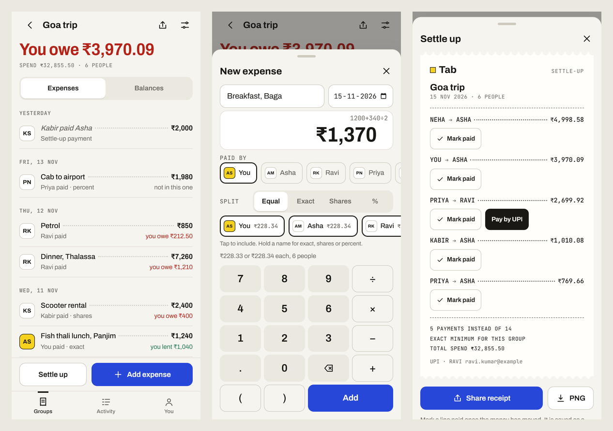
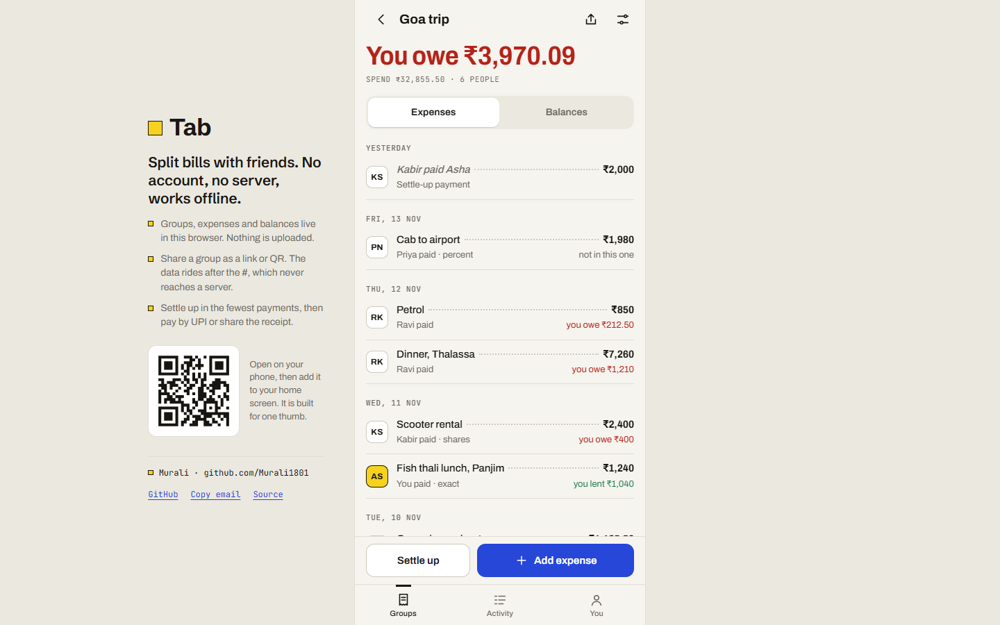

<p align="center">
  
</p>

<picture>
  <source media="(prefers-color-scheme: dark)" srcset="docs/screenshot-dark.png">
  
</picture>

# Tab

**Split bills with friends. No account, no server, works offline.**

Live demo: https://tab.vercel.app (TODO: not deployed yet)

## Quick start

```bash
npm install
npm run dev        # http://localhost:5173
npm test           # Vitest: splits, remainders, balances, settle-up, parser, share links
npm run build      # type-check, then build the PWA into dist/
npm run preview    # serve dist/ with the service worker
```

Offline test: open the preview once, then turn on airplane mode (or DevTools, Network, Offline) and reload. The app, its fonts and your groups all load from the device.

## Features

- **Groups, people, expenses.** Split equally, by exact amounts, by shares or by percent. Payer and participants per expense, a date, edit and delete with an Undo toast.
- **Whole-paise maths.** Every amount is an integer of minor units. Leftover paise go to the largest fractional parts, ties in member order, so totals always add up and the same input always gives the same split.
- **Expression keypad.** A custom keypad in a bottom sheet takes `1200+340/2` and shows the result as you type. Tap people chips to include them; hold a chip (or right-click) to give that person an exact amount, shares or a percent.
- **Settle-up receipt.** The fewest payments, printed as a till receipt with a perforated edge, dotted leaders and mono lines. Mark a line paid, pay by UPI when the person has a UPI ID, or share the receipt as a PNG plus text.
- **Provably minimal plan.** Exact minimum for up to 12 people with a balance, greedy beyond that. The receipt only says "5 payments instead of 14" when both numbers were computed for this group.
- **Share without a server.** A group packs into the link after `#g=`, deflated and base64url-encoded, with a QR code. Opening it on another phone merges safely: newest edit of each expense wins, deletes travel as tombstones, people are never removed.
- **Offline-first PWA.** IndexedDB storage, a Workbox precache of every file including fonts, installable with its own icon.
- **Feels native.** One-thumb layout, three-tab bar, drag-to-dismiss sheets with snap points, View Transitions between screens, light haptics where the device supports them, safe-area insets, light and dark themes.
- **Activity log** of everything added, edited, deleted, settled or imported, and a JSON export of all data.

INR is the default; USD, EUR, GBP, AED, SGD, THB and JPY are available per group.

## How it compares

| | Accounts | Server needed | Offline | Ads or limits | Stars (Nov 2026) |
|---|---|---|---|---|---|
| Splitwise (free tier) | Yes | Hosted | Partial (apps) | Ads, daily expense limit | closed source |
| [Spliit](https://github.com/spliit-app/spliit) | No | Yes, Postgres (or use spliit.app) | Needs its server | None | 3,062 |
| [SplitPro](https://github.com/oss-apps/split-pro) | Yes | Self-hosted | Needs its server | None | 1,492 |
| [I Hate Money](https://github.com/spiral-project/ihatemoney) | No (group password) | Self-hosted | Needs its server | None | 1,395 |
| [Kostos](https://github.com/shynewt/kostos) | No (invite token) | Encrypted sync relay | Yes, CRDT in IndexedDB | None | 59 |
| **Tab** | No | None | Yes, from the first visit | None | new |

Spliit has receipt scanning and categories, Kostos has live end-to-end encrypted sync, and both are good. Tab trades live sync for having no server at all: groups move by link or QR.

## How it works

**Money.** `src/core/split.ts` turns any split into integer weights (1 each for equal, shares, or basis points for percent) and calls `distribute(total, weights)`: each person gets `floor(total * w / W)` and the leftover units go one each to the largest remainders. BigInt keeps `total * w` exact.

**Balances.** For every expense the payer gets `+amount` and each participant `-share`. A "mark paid" is stored as a payment expense from the debtor to the creditor, so balances need no special case.

**Settle-up** (`src/core/settle.ts`). Greedy pairs the largest debtor with the largest creditor and needs at most n - 1 payments. The true minimum is NP-hard in general, but small groups are easy: if the n non-zero balances can be split into k groups that each sum to zero, n - k payments suffice and nothing does better. A DP over all 2^n subsets finds the largest k in O(2^n · n), which is instant for n ≤ 12; greedy then settles each zero-sum group on its own. Property tests check that every plan nets everyone to exactly zero, that exact never loses to greedy, and that exact matches a brute-force search.

**Expressions** (`src/core/expr.ts`). A hand-written recursive-descent parser (no `eval`) over exact fractions, rounded to paise once at the end, so `0.1+0.2` is `0.30` and `100/3*3` is `100.00`.

**Share links** (`src/core/share.ts`). Compact JSON, `CompressionStream('deflate-raw')`, base64url, in the fragment. Fragments are never sent to any server, including the one hosting Tab. Incoming data is validated field by field before it is merged.

**Sheets** (`src/ui/sheet.ts`). One small module with `open(el, { snap })` and `close()`: a modal `<dialog>`, pointer-driven drag with velocity projection, rubber band past the top, a critically damped spring, and no motion under `prefers-reduced-motion`. It is the swap point for [Sheet](https://github.com/Murali1801/sheet), the `<bottom-sheet>` Web Component from the same set.

**Bundle.** About 32 kB of JavaScript gzipped for the app (Preact, idb and Tab itself), 6 kB of CSS, plus a 4 kB QR chunk that loads on demand. Fonts are self-hosted subsets of Archivo, JetBrains Mono and Schibsted Grotesk (SIL OFL), about 100 kB in total.

## Contributing

Issues and pull requests are welcome. Keep the core (`src/core`) free of DOM code so it stays testable, add a test with every maths change, and run `npm test` and `npm run build` before opening a PR. `npm run icons` redraws the app icons from the brand colours.

## License

MIT © 2026 Muralidhar Acharya

---

<sub>■ Part of a set of tools by Murali: Tonal · Sheet · Tab · Masthead</sub>
